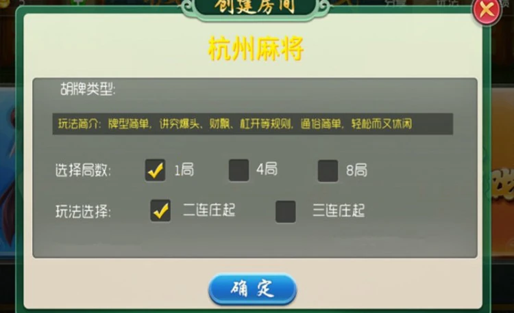

# 钱塘在线杭州麻将：房间选项与配置校验

钱塘在线这一版本围绕杭州麻将展开。公开介绍标注“网狐版本”及客户端Cocos2D，列出服务端、安卓与苹果客户端、开发库、配置工具和数据库。这里只把这些作为版本介绍信息，不据此推断引擎版本、编译环境或数据库产品；没有下载、编译或验证原工程。

## 登录与大厅

登录界面采用竹林背景与人物插画，提供微信登录及用户协议勾选框。按钮的存在只能说明界面入口，不能证明微信登录服务已配置或可用。

大厅将“创建房间”和“加入游戏”作为两个主要入口。分享、玩法、战绩和设置放在右上角。创建流程需要选择规则；加入流程则应以既有房间配置为准，避免两种流程共用一份可随意覆盖的本地状态。

## 房间选项

截图显示局数可选1、4、8局，玩法选项为“二连庄起”和“三连庄起”。两个字段应该独立保存，不能把局数误当作连庄门槛。

文字介绍还列出136张牌及爆头、财飘、杠开等玩法术语。但介绍中的“2老起、3老起”与界面选项不宜未经核验就视为完全等价；实际胡牌、连庄及结算语义需要完整规则与实现确认。本文不根据截图实现计分算法。

## 独立示例：校验房间配置

下面用一个独立函数演示如何将表单选项转换为稳定的数据结构。示例只支持截图中可见的局数与两种选项，并非原工程代码。

~~~js
import { validateRoom } from './room-options.mjs';
const config = validateRoom({
  rounds: 4,
  dealerStart: 'three'
});
console.log(config);
~~~

[完整代码](room-options.mjs)对字段类型、允许值和未知字段一起检查。它拒绝字符串形式的数字，不自动把“4”转换成4，也不会默默接收拼写错误的字段。返回新对象，避免表单继续编辑时改变已经确认的配置。

前端校验用于及时提示错误；真实服务端仍应独立验证请求和房间权限，不能直接信任客户端传入的数据。这里没有真实开房、网络请求或任何交易功能。

运行：

~~~bash
node test.mjs
~~~

[测试](test.mjs)提供12项断言，覆盖所有合法局数、两种玩法标识、错误类型、无效选项、额外字段和对象隔离。测试只验证这个独立示例。

## 配图与交流

第三方界面图片不宣称原创。大厅去掉模拟器工具栏，已有账号头像与ID替换为演示值；原图无昵称，因此没有新增昵称字段。品牌与原有功能保持，编辑后的图片不作为原始截图或运行验证。

技术交流：[Telegram](https://t.me/root4433)
